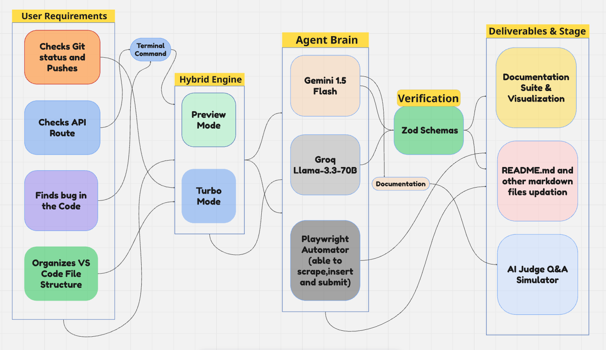

# 🚀 RepoPilot

> **Autonomous Repository Co-Pilot & Automation Engine**  
> Streamline workspace health, automated semantic git workflows, and dual-mode execution via CLI and VS Code.

---

<p align="center">
  
</p>

<p align="center">
  <b>Figure 1:</b> <em>RepoPilot Architecture & Execution Flow</em>
</p>

---

## 📌 Overview

**RepoPilot** is a developer tool and VS Code extension that automates repository maintenance, monitors code health, and streamlines Git workflows. It features a **Hybrid Execution Engine** allowing seamless switching between safe, interactive dry-runs (**Preview Mode**) and high-velocity autonomous task execution (**Turbo Mode**).

### Key Capabilities
- **Dual-Mode Engine**: Toggle between Preview Mode (safe inspection) and Turbo Mode (autonomous execution).
- **Semantic Commit Drafter**: Auto-generates conventional commit messages based on staged and unstaged file diffs.
- **Passive Workspace Monitoring**: Tracks dependency integrity and checks API contracts directly inside VS Code.
- **Custom Workflow Automation**: Define and run project-specific scripts via `.repopilot.json`.

---

## 🏛️ System Architecture

RepoPilot follows a 5-stage pipeline (illustrated in Figure 1):
1. **User Requirements**: Terminal commands and VS Code workspace triggers.
2. **Hybrid Engine**: Runtime mode router managing **Preview Mode** and **Turbo Mode**.
3. **Agent Brain**: Multi-agent consensus layer for code analysis and task coordination.
4. **Verification & Guardrails**: Schema validation and safety checks before changes are applied.
5. **Deliverables**: Semantic commits, updated documentation, and validated repository state.

---

## 🛠️ Tech Stack

- **Runtime**: Node.js & TypeScript
- **Editor Integration**: VS Code Extension API
- **Build Tooling**: esbuild & tsc
- **Version Control**: Git CLI

---

## 🚀 Getting Started

### Prerequisites
- [Node.js](https://nodejs.org/) (v18.0.0 or higher)
- [Git](https://git-scm.com/) configured locally

### Installation

1. **Clone the repository:**
   ```bash
   git clone https://github.com/your-username/RepoPilot.git
   cd RepoPilot
   ```

2. **Install dependencies and compile:**
   ```bash
   npm install
   npm run compile
   ```

3. **(Optional) Link CLI globally:**
   ```bash
   npm link
   ```
   *You can now execute `repopilot` directly from any terminal. Alternatively, use `npx repopilot` or `node bin/repopilot.js`.*

---

## 💻 Command Reference & Usage

RepoPilot provides commands through both its **Command-Line Interface (CLI)** and the **VS Code Command Palette**.

### 1. CLI Commands

Run commands using `repopilot <command>`, `npx repopilot <command>`, or `node bin/repopilot.js <command>`.

| Command / Flag | Shortcut | Description |
|---|---|---|
| `repopilot --enable turbo mode` | `repopilot --turbo` | Switch to Turbo Mode (autonomous execution) |
| `repopilot --enable preview mode` | `repopilot --preview` | Switch to Preview Mode (safe dry-run inspection) |
| `repopilot --status` | `repopilot status` | Display active mode and workspace state |
| `repopilot --draft-commit` | `repopilot draft-commit` | Analyze git changes and suggest semantic commit message |
| `repopilot <custom-command>` | — | Execute a custom script configured in `.repopilot.json` |
| `repopilot --help` | `repopilot -h` | Display the CLI help menu |

---

#### ⚡ Mode Switching Commands

Control the operational state of the Hybrid Engine. Changes are persisted to `.repopilot.json` and sync with the VS Code status bar in real time.

- **Enable Turbo Mode:**
  ```bash
  repopilot --enable turbo mode
  # or
  repopilot --turbo
  ```
  *Output:*
  ```text
  🚀 RepoPilot CLI [Hybrid Engine]
  ──────────────────────────────────────────────────
  ⚡ Turbo Mode Enabled
     Autonomous execution, fast-track validation & direct fixes are now active.
     Configuration saved to .repopilot.json
  ```

- **Enable Preview Mode:**
  ```bash
  repopilot --enable preview mode
  # or
  repopilot --preview
  ```
  *Output:*
  ```text
  🚀 RepoPilot CLI [Hybrid Engine]
  ──────────────────────────────────────────────────
  🔍 Preview Mode Enabled
     Interactive inspection, diff previewing & dry-runs are now active.
     Configuration saved to .repopilot.json
  ```

---

#### 📊 Workspace Status Command

Check the currently active engine mode, workspace root directory, config file status, and registered custom commands:

```bash
repopilot --status
# or
repopilot status
```

*Example Output:*
```text
🚀 RepoPilot CLI [Hybrid Engine]
──────────────────────────────────────────────────
Current Mode:       ⚡ Turbo Mode
Workspace Root:     /path/to/project
Configuration:      .repopilot.json (present)
Custom Commands:    audit, lint-fix
──────────────────────────────────────────────────
```

---

#### ✍️ Semantic Commit Drafter

Scans modified and untracked files via `git status` and proposes conventional commits (`feat:`, `fix(deps):`, `feat(api):`, `docs:`, etc.):

```bash
repopilot --draft-commit
# or
repopilot draft-commit
```

*Example Output:*
```text
🚀 RepoPilot CLI [Hybrid Engine]
──────────────────────────────────────────────────
Found 2 changed file(s):
  • M src/cli/index.ts
  • M README.md

💡 Suggested commit message:
  docs: update repository documentation
──────────────────────────────────────────────────
```

---

#### ⚙️ Custom Commands (`.repopilot.json`)

Define project-specific scripts inside `.repopilot.json` under `"customCommands"` to run complex workflows with short aliases:

```json
{
  "mode": "preview",
  "customCommands": {
    "audit": "npm test && git status",
    "lint-fix": "npm run lint -- --fix",
    "build-all": "npm run compile && npm run package"
  }
}
```

Run custom commands directly by name:
```bash
repopilot audit
repopilot lint-fix
```

---

### 2. VS Code Extension Commands

Access these commands from the VS Code **Command Palette** (`Ctrl+Shift+P` on Windows/Linux or `Cmd+Shift+P` on macOS):

| Command Palette Title | Internal ID | Action |
|---|---|---|
| `RepoPilot: Enable Turbo Mode` | `repopilot.enableTurboMode` | Switches engine to Turbo Mode and updates status bar |
| `RepoPilot: Enable Preview Mode` | `repopilot.enablePreviewMode` | Switches engine to Preview Mode and updates status bar |
| `RepoPilot: Draft Semantic Commit` | `repopilot.draftCommit` | Generates semantic commit message and pastes it into the SCM input box |
| `RepoPilot: Run Turbo Mode` | `repopilot.turboMode` | Triggers autonomous execution pipeline |
| `RepoPilot: Run Sprint Logistics` | `repopilot.sprintLogistics` | Triggers submission & sprint logistics routines |

#### 🔘 Status Bar Toggle

RepoPilot adds an interactive item to the bottom-right of the VS Code status bar:
- When in Turbo Mode: Displays **`$(zap) RepoPilot: Turbo`** (with warning accent). Clicking toggles to Preview Mode.
- When in Preview Mode: Displays **`$(eye) RepoPilot: Preview`**. Clicking toggles to Turbo Mode.

---

## 🗺️ Roadmap

- [x] Hybrid Engine CLI architecture (`--preview` vs `--turbo`)
- [x] Config persistence via `.repopilot.json`
- [x] Semantic Git commit synthesis
- [x] VS Code status bar mode switcher & command integration
- [ ] Automated API contract verification CLI integration
- [ ] Interactive Judge Q&A terminal simulation

---

## 📄 License

This project is licensed under the [MIT License](LICENSE).
